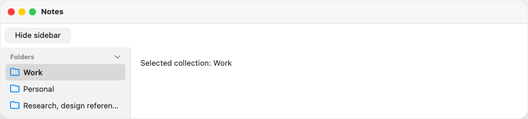

# CGP Desktop UI

macOS Components for React is an open-source React 19 component library for building macOS-inspired web interfaces. It includes light and dark themes, design tokens, interaction patterns, and bilingual documentation.

[English documentation](https://cgpdesktopui.com/en/desktop/getting-started/introduction) · [中文文档](https://cgpdesktopui.com/) · [中文 README](README.zh-CN.md)

[](https://cgpdesktopui.com/en/desktop/sidebar)

## Install

In your React 19 project, run

```sh
npm install @cgpdesktopui/ui
```

## Install from source

Use Node.js 22.12+ and pnpm 11.25.0.

```sh
git clone https://github.com/devcgp/macos-components-react.git
cd macos-components-react
pnpm install --frozen-lockfile
pnpm --filter @cgpdesktopui/ui build
pnpm --filter @cgpdesktopui/ui pack --pack-destination .
```

In your React 19 project, install the tarball using its actual path.

```sh
pnpm add /path/to/cgpdesktopui-ui-0.1.0.tgz
```

```tsx
import { Button } from '@cgpdesktopui/ui'
import '@cgpdesktopui/ui/styles.css'

export function App() {
  return (
    <div data-theme="desktop">
      <Button variant="accent">Continue</Button>
    </div>
  )
}
```

Add the `.dark` class to the host root to use dark appearance.

## Develop locally

Run `pnpm dev` from the repository root to open the docs site at http://127.0.0.1:8897/.

```sh
pnpm tokens --check
pnpm build
pnpm typecheck
pnpm exec playwright install chromium
pnpm test
```

See the [contribution guide](CONTRIBUTING.md) and [architecture notes](docs/architecture.md).

## License

Project code is available under the [MIT license](LICENSE). See the [provenance notes](docs/PROVENANCE.md) for third-party assets and design references.
